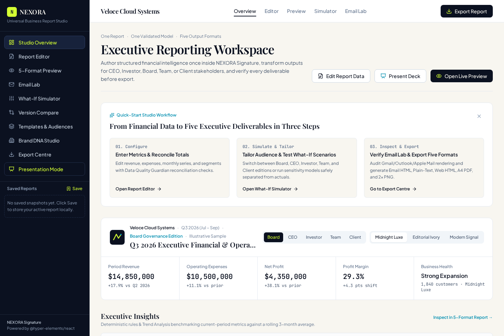
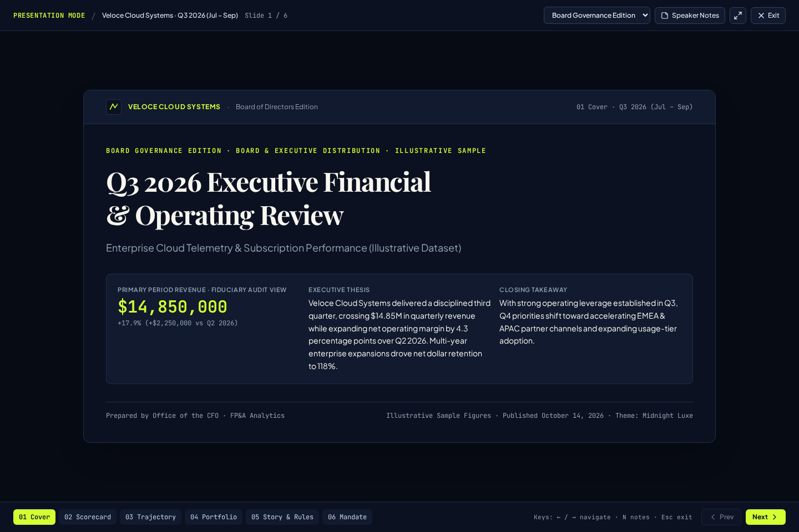
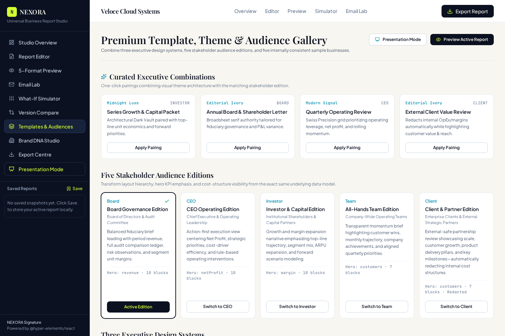
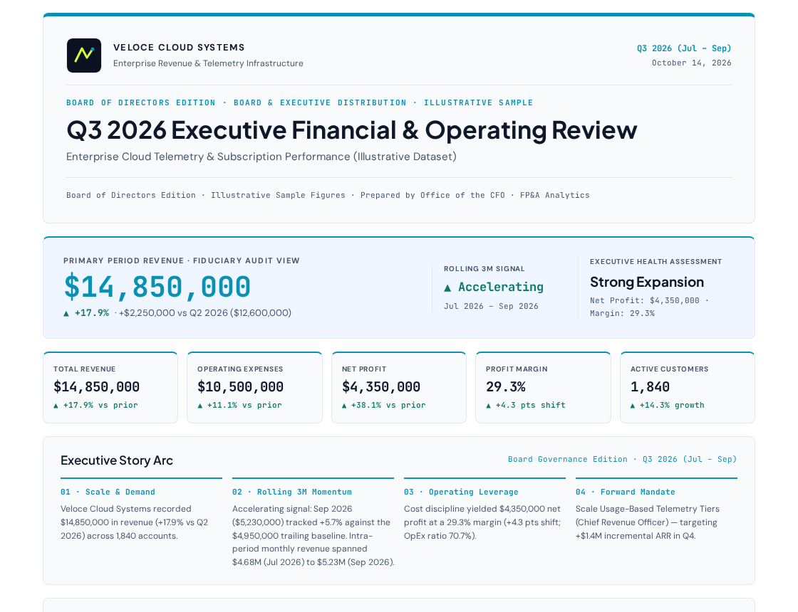
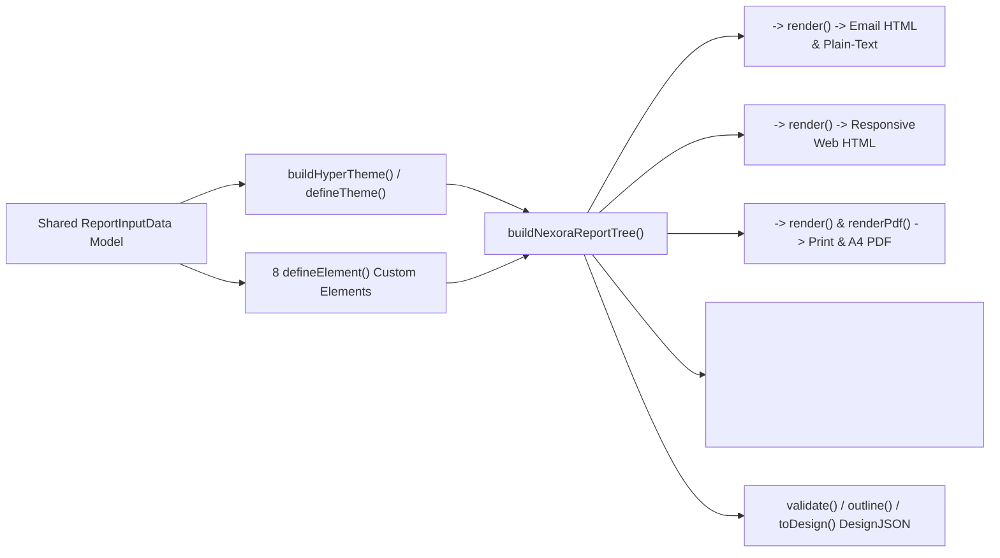

# NEXORA Signature — Universal Business Report Studio

**One Report. One Data Model. Five Output Formats.**

NEXORA Signature is an executive business intelligence and multi-format reporting studio built for the **Unlayer Hyper Elements Template Challenge**. It transforms a single validated financial and operating data model into synchronized deliverables powered by official `@hyper-elements/react` (`v0.5.0`) multi-target rendering (`<Email>`, `<Page>`, `<Document>`, and `<Canvas>`) paired with native `@hyper-elements/react/pdf`, `@hyper-elements/react/image`, and Playwright Chromium A4 PDF / 2x PNG pipelines.

---

## Visual Showcase

### Studio Workspace & Interactive Presentation Mode

| Studio Overview & Quick Pulse | Executive Presentation Mode (6–7 Slides + Speaker Notes) |
| :---: | :---: |
|  |  |

### Five-Format Rendering, Genuine Export Quality & Template Gallery

| 5-Format Live Report Studio (`100/100`) | Genuine Export Quality Scorecard & Data Guardian |
| :---: | :---: |
|  |  |

| Curated Theme × Audience Template Gallery |
| :---: |
|  |

### Three Distinct Editorial & Executive Design Systems

| Midnight Luxe (Boardroom Charcoal & Electric Lime) | Editorial Ivory (Broadsheet Serif & Crisp Ivory) | Modern Signal (Precision Slate & Emerald/Cyan) |
| :---: | :---: | :---: |
|  |  |  |

---

## Key Capabilities

1. **Executive Intelligence Engine & Rolling 3-Month Trend Analysis** — Generates deterministic financial observations and strategic recommendations from actual period metrics (complete with `ruleTriggered` and `formulaTrace` attribution), alongside a **Trend Analysis** module comparing latest-month figures against rolling 3-month averages to surface `Accelerating`, `Steady`, and `Decelerating` momentum signals.
2. **Executive Presentation Mode** — Launches a full-viewport boardroom slide deck (`←` / `→` / `Space` / `N` / `Esc` shortcuts, live audience edition switcher, fullscreen toggle, Speaker Notes) synced directly to the active report model and honoring Client-edition cost redaction.
3. **Genuine Export Quality Scorecard (`0–100`)** — Asynchronously audits live rendered artifacts across 5 dimensions (**Data Integrity & Reconciliation**, **Email Deliverability & Clients**, **Web HTML & SVG Charts**, **Print & A4 PDF Pagination**, and **Plain-Text & Audience Governance**), verifying Gmail's `102 KB` ceiling (`91.8–96.6 KB` across all 5 sample datasets), zero `<script>` tags, WCAG AA contrast, native `@hyper-elements/react` `validate()` `0` error/warning diagnostics, `@page` print CSS, and audience redaction.
4. **What-If Business Simulator** — Computes hypothetical revenue, operating expense, customer, and ARPU scenarios in isolation (`isProjection: true`), rendering SVG overlays and optional strictly labeled non-actual report appendices (`HYPOTHETICAL WHAT-IF PROJECTION — NON-ACTUAL SCENARIO`).
5. **Audience Transformation** — Adapts **Board Governance**, **CEO Operating**, **Investor & Capital**, **All-Hands Team**, and **Client & Partner** editions from one shared tree—reordering sections, tuning hero KPI focus, and automatically redacting internal operating expenses and margins in the Client edition.
6. **Five-Format Live Preview & Export Centre** — Preview and export **Email HTML**, **Plain-Text Email**, **Responsive Web HTML**, **A4 PDF** (`@hyper-elements/react/pdf` native `renderPdf()` + Playwright Chromium full web-font fallback), and **PNG** (`@hyper-elements/react/image` 2400×1600 native `<Canvas>` summary card + Playwright 2x full-report snapshot), plus `@hyper-elements/react/builder` `DesignJSON`.
7. **Email Compatibility Lab** — Emulates **Gmail Web (640px)**, **Outlook Desktop**, **Apple Mail**, and **Mobile Email (375px)** with deterministic checks for payload weight (`<= 102 KB`), Outlook MSO conditionals, table-based Unicode block sparklines (`█` / `▓`), inline `data:image/*` detection with hosted-HTTPS warnings for Gmail, image `alt` coverage, `<html lang>`, and WCAG contrast.
8. **Brand DNA Studio** — Configures uploaded (`PNG`/`JPEG`/`WEBP`/`SVG`) or **Hosted HTTPS Logo URLs** (recommended for Gmail and native PDF), frame geometry (`rounded` / `square` / `circle`), Google Font typography presets, cover layout style overrides, sanitized accent colors, and governance disclosures across every output format.
9. **Data Quality Guardian & Debounced Auto-Save** — Runs 8 real-time schema, reconciliation, and security checks with one-click total alignment, paired with `500ms` debounced `localStorage` persistence and `pagehide` / `beforeunload` flushing.
10. **Report Version Comparison & Curated Template Gallery** — Computes KPI, category, and metadata diffs between snapshots, and provides one-click Theme × Audience combinations across five illustrative sample companies (`Veloce Cloud Systems`, `Nordic Hearth Retail`, `Harborstone Logistics`, `Aurelia HealthTech`, `Kinetix Commerce`).

---

## Official `@hyper-elements/react` (`v0.5.0`) Integration

NEXORA Signature renders natively with `@hyper-elements/react` (`0.5.0`) custom components and multi-root architecture—using Hyper Elements primitives rather than hand-written HTML string templates:



- **Document Roots**: `<Email>`, `<Page>`, `<Document>` (with `<PageHeader>`, `<PageFooter>`, `<PageNumber />`, and `<PageBreak />`), and `<Canvas width={1200} height={800}>`
- **Theme Token Engine (`src/elements/hyperTheme.ts`)**: `defineTheme()` dynamically maps `Midnight Luxe`, `Editorial Ivory`, and `Modern Signal` plus Brand DNA typography/accent overrides.
- **8 Native `defineElement()` Components (`src/elements/custom/` & `src/elements/tools.tsx`)**:
  - `nexora.CoverBanner` (`NexoraCoverBanner.tsx`) — Branded cover banner, classification tags, sanitized logo geometry, and metadata
  - `nexora.HeroKpi` (`NexoraHeroKpi.tsx`) — Audience-targeted flagship KPI card with Rolling 3M momentum badge
  - `nexora.KpiStrip` (`NexoraKpiStrip.tsx`) — Multi-column financial KPI grid with Client-edition expense redaction
  - `nexora.StoryArc` (`NexoraStoryArc.tsx`) — 4-beat **Executive Story Arc** (`Scale & Demand`, `Rolling 3M Momentum`, `Operating Leverage`, `Forward Mandate`)
  - `nexora.TrendChart` (`NexoraTrendChart.tsx`) — Lean HTML table sparklines in `<Email>`; native `<Svg>` (`<Rect>`, `<Line>`, `<Circle>`) Revenue/Expenses bars, dashed Rolling 3M Avg benchmark, and Net Profit curve in `<Page>`, `<Document>`, and `<Canvas>`
  - `nexora.BreakdownChart` (`NexoraBreakdownChart.tsx`) — Revenue streams, cost drivers, and operating segment mix (Client-redacted)
  - `nexora.InsightsBlock` (`NexoraInsightsBlock.tsx`) — Rolling 3-Month Trend Analysis table, Verified Financial Observations (`ruleTriggered` + formula trace), and Analytical Recommendations (with `part` pagination support for `<Document>`)
  - `nexora.SimulationAppendix` (`NexoraSimulationAppendix.tsx`) — Strictly separated non-actual What-If projection table
- **Package Subpath APIs Verified**:
  - Core (`@hyper-elements/react`): `defineElement`, `prop`, `defineTheme`, async `render()`, `validate()`, `outline()`
  - Builder (`@hyper-elements/react/builder`): `toDesign()` (`POST /api/export/design-json`)
  - Native PDF (`@hyper-elements/react/pdf`): `renderPdf()` (`POST /api/export/native-pdf`)
  - Native Image (`@hyper-elements/react/image`): `renderImage()` (`POST /api/export/canvas-png`)

---

## Project Structure

```text
src/
├── core/
│   ├── types.ts                  # Canonical ReportInputData, Brand DNA, Simulation & Guardian schemas
│   ├── calculations.ts           # Deterministic financial math (net profit, margins, growth, ARPU)
│   ├── audiences.ts              # 5 Audience Transformation specs & cost-redaction policy
│   ├── simulator.ts              # What-If projection calculator (isProjection: true)
│   ├── emailAudit.ts             # Email client emulation + Gmail/Outlook/Apple Mail/WCAG AA checks
│   ├── exportQuality.ts          # Async 0-100 Export Quality scorecard & validate() verification
│   ├── versionDiff.ts            # KPI, category, segment & metadata diff engine
│   ├── validation.ts             # Data Quality Guardian 8-point checks & reconciliation warnings
│   ├── intelligence.ts           # Rule-based observations, Rolling 3M Trend Analysis & recommendations
│   ├── security.ts               # HTML escaping, hex color sanitization, safe filenames & SVG checks
│   ├── themes.ts                 # 3 editorial themes + Brand DNA typography/cover resolver
│   └── samples.ts                # 5 illustrative industry sample datasets
├── elements/
│   ├── custom/                   # 8 @hyper-elements/react defineElement() modules + shared helpers
│   ├── tools.tsx                 # NEXORA_CUSTOM_ELEMENTS registry exporting all 8 element specs
│   ├── hyperTheme.ts             # buildHyperTheme() adapter for @hyper-elements/react defineTheme()
│   ├── NexoraReportDocument.tsx  # Unified <Email>, <Page>, <Document>, and <Canvas> report trees
│   ├── renderers.ts              # Async render(), validate(), outline(), and toDesign() helpers
│   └── serverRenderers.ts        # Node-only @hyper-elements/react/pdf & /image font-loaded wrappers
├── hooks/
│   └── useAutoSaveReport.ts      # 500ms debounced + pagehide/beforeunload localStorage auto-save
├── components/                   # Overview, Editor, Live Studio, Presentation, Email Lab, Simulator, Versions, Templates, Brand DNA, Export Centre
├── services/storage.ts           # Browser localStorage persistence for drafts & version snapshots
server.ts                         # Express + Vite server + Playwright Chromium & native PDF/PNG export endpoints
tests/nexora.test.ts              # 27 automated Vitest unit & integration tests
docs/screenshots/                 # Captured UI, Presentation Mode, Export Scorecard & Theme previews
```

---

## Known Limitations & Engineering Notes

- **Embedded Preset Logos (`data:image/*`) in Gmail & Native PDF**: The five bundled illustrative sample datasets use inline `data:image/svg+xml` logos so the workspace runs cleanly offline. Gmail strips `data:image/*` URIs (both inline SVG and base64) on delivery, and `@hyper-elements/react/pdf` skips inline SVG data URIs when drawing PDF pages. The **Email Compatibility Lab** actively detects embedded data URIs (`gmail-inline-images`) and recommends setting a **Hosted HTTPS PNG/JPEG Logo URL** inside **Brand DNA Studio** before production distribution.
- **Font Rendering in Native `renderPdf()` / `renderImage()` vs. Playwright**: Native `@hyper-elements/react/pdf` (`POST /api/export/native-pdf`) and `@hyper-elements/react/image` (`POST /api/export/canvas-png`) execute cleanly in Node without launching Chromium, using standard system/sans fonts unless custom `.ttf`/`.otf` buffers are registered. Use the **Playwright Chromium A4 PDF / 2x PNG** exporters (`POST /api/export/pdf` and `POST /api/export/png`) whenever exact Google Web Font typography (`Cormorant Garamond`, `Playfair Display`, `Inter`, `JetBrains Mono`) is required.
- **Playwright Chromium Dependency**: Full-report Chromium PDF/PNG exports require an available Chromium binary (`npx playwright install chromium` or `PLAYWRIGHT_CHROMIUM_EXECUTABLE_PATH`); native `@hyper-elements/react/pdf` and `@hyper-elements/react/image` remain functional even without Playwright browser binaries.
- **Retained `@google/genai` Package**: `@google/genai` remains installed in `package.json` for AI Studio environment compatibility; all financial computations, observations, trend analysis, and What-If sensitivity modeling inside NEXORA Signature are deterministic.

---

## Cross-Platform Setup & Verification (Windows, macOS & Linux)

NEXORA Signature uses `fileURLToPath`, OS-aware Playwright Chromium launch arguments, Node-native `fs.rmSync` clean scripts, and `.gitattributes` LF normalization for portability across Windows PowerShell/CMD, macOS, and Linux (`npm` is the canonical package manager with lockfile `package-lock.json`).

```bash
# 1. Install dependencies & Playwright Chromium browser
npm install
npx playwright install chromium

# 2. Start the full-stack studio (Vite + Express on http://localhost:3000)
npm run dev

# 3. Run automated verification
npm test      # 27/27 Vitest unit + Playwright + native PDF/image tests
npm run lint  # tsc --noEmit strict TypeScript check
npm run build # Production Vite client bundle (dist/)

# 4. Run production server or clean artifacts
npm run start
npm run clean
```

---

## License


This project is licensed under the MIT License. See the [LICENSE](./LICENSE) file for details.