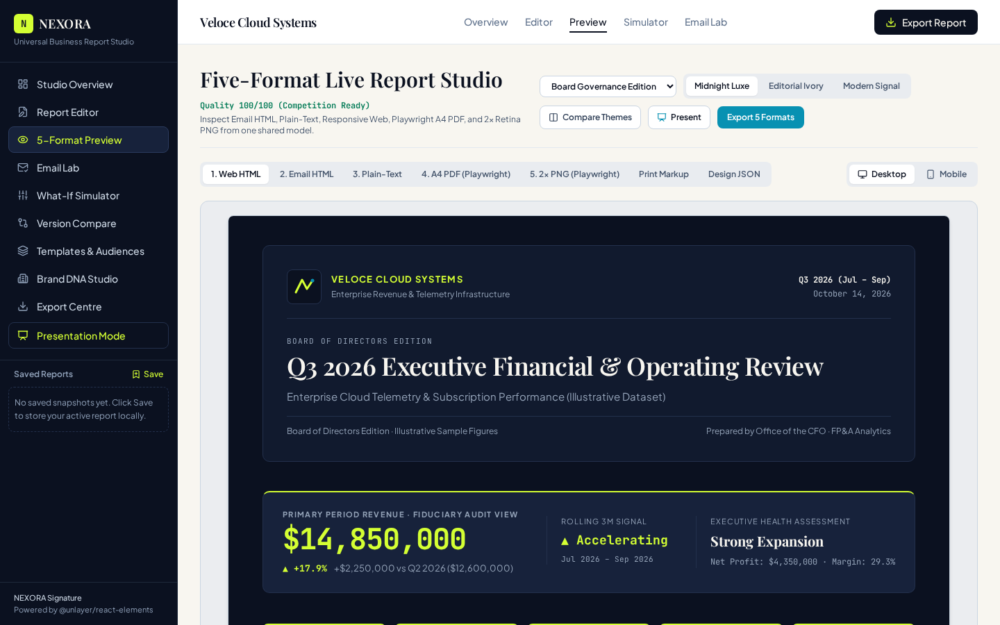
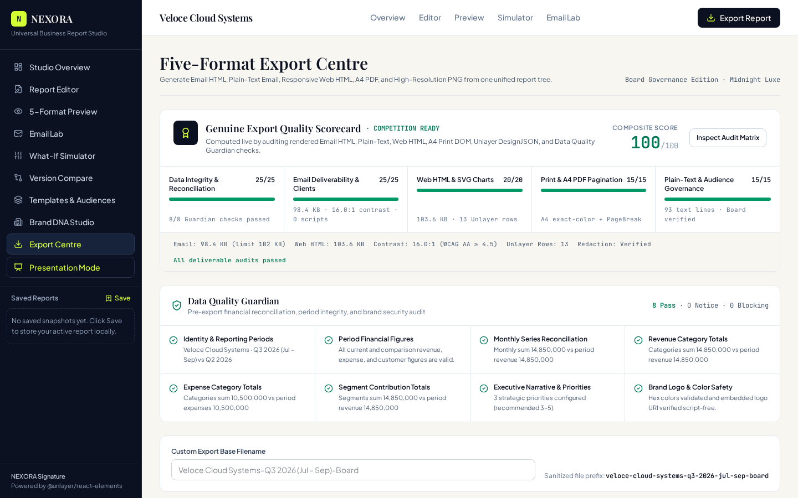

# NEXORA Signature — Universal Business Report Studio

**One Report. One Data Model. Five Output Formats.**

NEXORA Signature is an executive business intelligence and multi-format reporting studio built for the **Unlayer Hyper Elements Template Challenge**. It transforms a single validated financial and operating data model into five synchronized, production-grade deliverables using `@unlayer/react-elements` (`v0.2.1`) and Playwright Chromium.

---

## Visual Showcase

### Studio Workspace & Interactive Presentation Mode

| Studio Overview & Quick Pulse | Executive Presentation Mode (6–7 Slides + Speaker Notes) |
| :---: | :---: |
|  |  |

### Five-Format Rendering, Genuine Export Quality & Template Gallery

| 5-Format Live Report Studio (`100/100`) | Genuine Export Quality Scorecard & Data Guardian |
| :---: | :---: |
|  |  |

| Curated Theme × Audience Template Gallery |
| :---: |
|  |

### Three Distinct Editorial & Executive Design Systems

| Midnight Luxe (Boardroom Charcoal & Electric Lime) | Editorial Ivory (Broadsheet Serif & Crisp Ivory) | Modern Signal (Precision Slate & Emerald/Cyan) |
| :---: | :---: | :---: |
|  |  |  |

---

## Core Capabilities

1. **Executive Intelligence Engine & Rolling 3-Month Trend Analysis** — Generates transparent, deterministic financial observations and strategic recommendations directly from period figures (with `ruleTriggered` and `formulaTrace` attribution), paired with a **Trend Analysis** module comparing the latest month against rolling 3-month averages to surface `Accelerating`, `Steady`, and `Decelerating` momentum signals.
2. **Executive Presentation Mode** — Launches a full-viewport boardroom deck (6–7 dynamically built slides per theme and audience edition) featuring keyboard shortcuts (`←` / `→` / `Space` / `N` / `Esc`), live audience edition switching, fullscreen toggle, toggleable Speaker Notes, and strict Client-edition internal cost redaction.
3. **Genuine Export Quality Scorecard (`0–100`)** — Evaluates live rendered artifacts across 5 scored dimensions (**Data Integrity & Reconciliation**, **Email Deliverability & Clients**, **Web HTML & SVG Charts**, **Print & A4 PDF Pagination**, and **Plain-Text & Audience Governance**), inspecting Gmail's 102 KB ceiling (`94.9–100.0 KB` across all 5 sample datasets), WCAG AA contrast, zero `<script>` tags, SVG charts, `@page` pagination rules, and Client-edition cost redaction.
4. **What-If Business Simulator** — Models hypothetical revenue, expense, customer, and ARPU scenarios instantaneously with SVG comparisons and optional non-actual report appendices strictly labeled and separated from audited actuals.
5. **Audience Transformation** — Produces **Board Governance**, **CEO Operating**, **Investor & Capital**, **All-Hands Team**, and **Client & Partner** editions from the same underlying data tree—automatically adapting hero KPI focus, section order, narrative priorities, and internal expense redaction (Client edition).
6. **Five-Format Live Preview & Export Centre** — Inspect and export **Email HTML** (Gmail clip-safe `< 102 KB`), **Plain-Text Email**, **Responsive Web HTML** (interactive SVG charts with dashed Rolling 3M average benchmarks & negative-profit zero baselines), **Playwright A4 PDF**, and **Playwright 2x Retina PNG**, alongside Print Markup and Unlayer `DesignJSON`.
7. **Email Compatibility Lab** — Emulates **Gmail Web (640px)**, **Outlook Desktop**, **Apple Mail**, and **Mobile Email (375px)** alongside deterministic checks for Gmail's 102 KB clipping threshold, zero `<script>` tags, MSO table layout structure, image alt-text coverage, and WCAG AA contrast ratios.
8. **Brand DNA Studio** — Customize corporate logo marks, frame geometry (`rounded` / `square` / `circle`), optical Google Font pairings (`Playfair Display`, `Newsreader`, `Plus Jakarta Sans`, `DM Sans`, `JetBrains Mono`), cover architecture overrides, accent hex colors, and governance disclosures across every output.
9. **Data Quality Guardian & Debounced Auto-Save** — Audits 8 financial, reconciliation, period, and brand-safety checks in real time with one-click reconciliation helpers, while debouncing report edits (`500ms` + `pagehide`/`beforeunload` flush) to `localStorage`.
10. **Report Version Comparison & Curated Template Gallery** — Compares active drafts against saved snapshots across KPI deltas and category/metadata shifts, and offers one-click **Curated Executive Combinations** (Theme × Audience) across 5 illustrative industry datasets (`Veloce Cloud Systems`, `Nordic Hearth Retail`, `Harborstone Logistics`, `Aurelia HealthTech`, `Kinetix Commerce`).

---

## Genuine `@unlayer/react-elements` Integration

NEXORA uses the official `@unlayer/react-elements` package (`v0.2.1`) as the single rendering backbone—never bypassing or replacing Hyper Elements with disconnected HTML strings:

- **Document Roots**: `<Email>`, `<Page>`, `<Document>`, and `<PageBreak />`
- **Custom Registered Tools (`registerTool`)**:
  - `nexora_cover_banner` — Dynamic brand header, metadata, and cover architecture
  - `nexora_hero_kpi` — Audience-targeted flagship KPI with Rolling 3M signal indicator
  - `nexora_kpi_strip` — 5-metric tabular summary grid (cost-redacted automatically for Client edition)
  - `nexora_story_arc` — 4-beat **Executive Story Arc** (`Scale & Demand`, `Rolling 3M Momentum`, `Operating Leverage`, `Forward Mandate`)
  - `nexora_trend_chart` — Monthly revenue/expense/profit SVG chart with zero-crossing profit baseline & dashed Rolling 3M Rev Avg benchmark
  - `nexora_breakdown_chart` — Revenue streams, cost drivers, and regional/segment distribution
  - `nexora_insights_block` — Deterministic intelligence observations, Rolling 3M Trend scorecard, and strategic priorities
  - `nexora_simulation_appendix` — Strictly labeled non-actual What-If projection appendix
- **Verified Rendering APIs**: `renderToHtml`, `renderToHtmlParts`, `renderToPlainText`, `renderToJson`

---

## Project Architecture

```text
src/
├── core/
│   ├── types.ts            # Canonical ReportInputData, Brand DNA, Simulation & Guardian schemas
│   ├── calculations.ts     # Deterministic financial math (net profit, margins, YoP growth, ARPU)
│   ├── audiences.ts        # 5 Audience Transformation specs (Board, CEO, Investor, Team, Client)
│   ├── simulator.ts        # What-If projection engine (strictly marked isProjection: true)
│   ├── emailAudit.ts       # Email client emulation + Gmail/Outlook/Apple Mail/WCAG AA checks
│   ├── exportQuality.ts    # Genuine 0-100 Export Quality scoring across all rendered outputs
│   ├── versionDiff.ts      # KPI, category, segment & metadata diff engine
│   ├── validation.ts       # Data Quality Guardian 8-point checks & reconciliation warnings
│   ├── intelligence.ts     # Rule-based insights, Rolling 3M Trend Analysis & recommendations
│   ├── security.ts         # HTML escaping, hex color sanitization, safe filenames & SVG checks
│   ├── themes.ts           # 3 distinct themes + Brand DNA font/cover resolver
│   └── samples.ts          # 5 internally consistent illustrative industry datasets
├── elements/
│   ├── tools.tsx           # 8 registered @unlayer/react-elements custom tools
│   ├── NexoraReportDocument.tsx  # Audience-ordered <Email>, <Page>, <Document> trees + MSO coalescing
│   └── renderers.ts        # renderToHtml, renderToHtmlParts, renderToPlainText, renderToJson
├── hooks/
│   └── useAutoSaveReport.ts # 500ms debounced + pagehide/beforeunload localStorage auto-save
├── components/             # Overview, Editor, Live Studio, Presentation Mode, Email Lab, Simulator, Versions, Templates, Brand DNA, Export Centre
├── services/storage.ts     # Browser localStorage persistence for drafts and saved snapshots
server.ts                   # Cross-platform Express + Vite server + Playwright Chromium PDF/PNG APIs
tests/nexora.test.ts        # 25 automated Vitest unit & Playwright integration tests
docs/screenshots/           # Captured UI, Presentation Mode, Export Scorecard & Theme previews
```

---

## Cross-Platform Setup & Verification (Windows, macOS & Linux)

NEXORA Signature uses cross-platform `fileURLToPath`, OS-aware Playwright Chromium launch arguments, Node-native `npm run clean`, and `.gitattributes` LF normalization so all scripts run smoothly across Windows PowerShell/CMD, macOS, and Linux.

```bash
# 1. Install dependencies & Playwright Chromium
npm install
npx playwright install chromium

# 2. Start the full-stack studio (Vite + Express + Playwright routes on http://localhost:3000)
npm run dev

# 3. Verify automated tests, TypeScript check, and production build
npm test      # 25/25 Vitest + Playwright Chromium tests
npm run lint  # tsc --noEmit strict type check
npm run build # Production Vite bundle (dist/)

# 4. Run production server or clean build artifacts
npm run start
npm run clean
```
